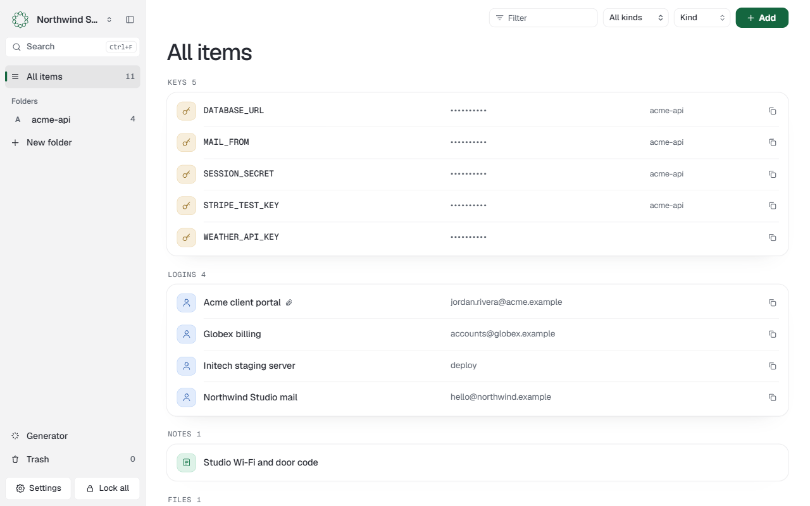
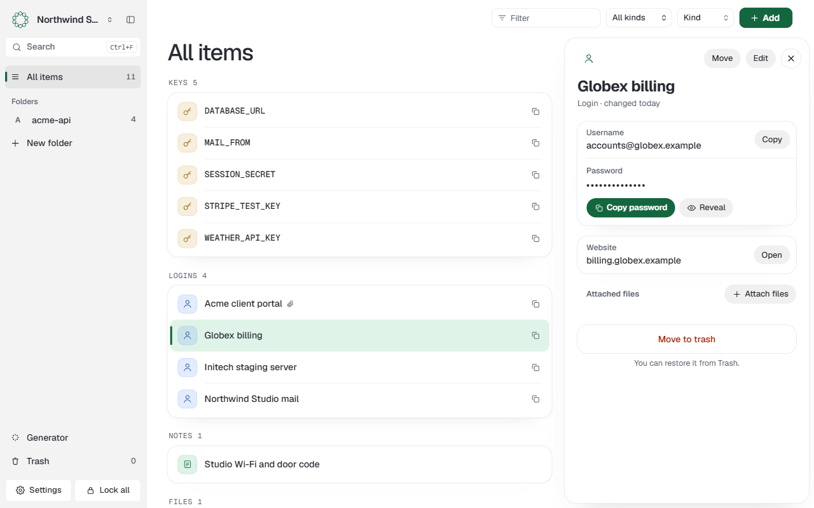
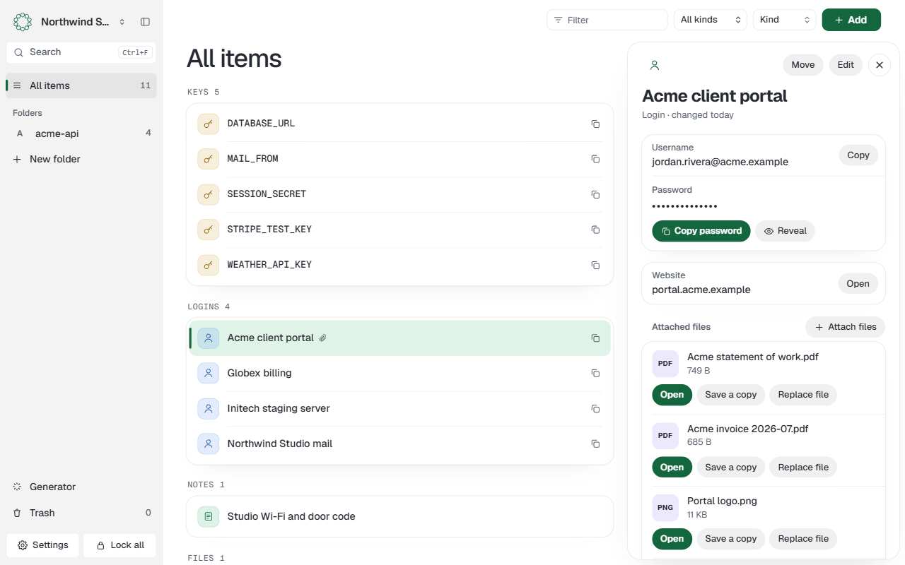
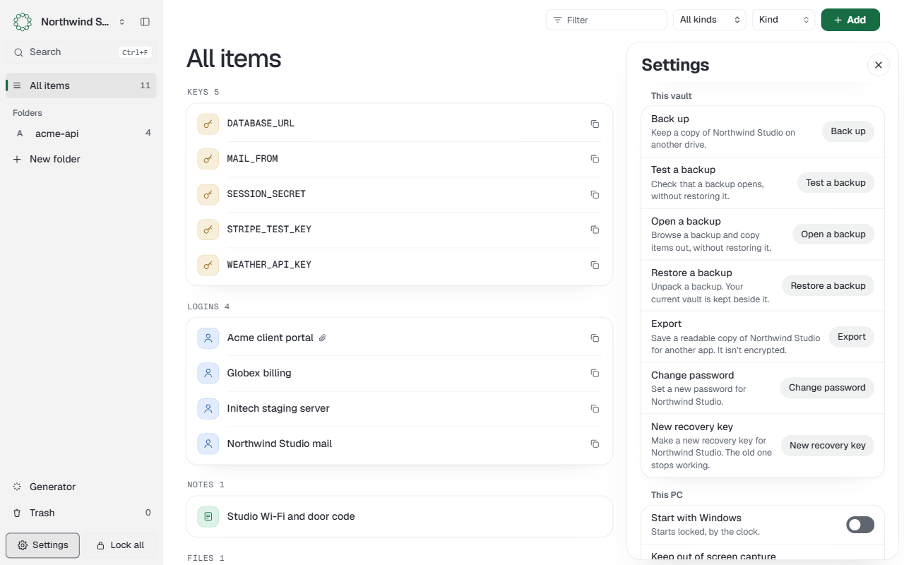

# Petalock

Petalock is a password manager and encrypted file vault for Windows that keeps everything on your own PC: no server, no
cloud. Besides passwords and notes, it is meant to store real files such as client contracts, design files and project
archives, grouped by client or project. It is an open-source portfolio project, aiming for production standards: tested,
documented and honest about its limits.

> **Status: early preview. Unsigned. Not independently audited. Don't store real passwords in it yet.**
>
> No independent security expert has audited Petalock's code or its encryption, and none is planned.
> The installer has no code signature, so your browser and Windows may warn you before it runs.
> The first preview isn't out yet (see [Download](#download)).



| | |
|---|---|
|  |  |
|  | Every name, address and key in these pictures is made up. |

## Download

Get Petalock from its download page, **https://petalock.arielmaningas.com**, or from
[Petalock's releases on GitHub](https://github.com/sumguywhowantstobuild/petalock/releases). Nowhere else is official. Until the first
preview is published, the releases list is empty and the download page offers no file ("Coming soon").

Each release's installer has a fixed address on GitHub, the one the download page links to:

```
https://github.com/sumguywhowantstobuild/petalock/releases/download/v<version>/Petalock_<version>_x64-setup.exe
```

You can check its fingerprint (SHA-256) before you open it: optional for a file from the download page or
[Petalock's releases on GitHub](https://github.com/sumguywhowantstobuild/petalock/releases). A copy from anywhere else:
download a fresh one from either, or check it before you open it, against the fingerprint on petalock.arielmaningas.com
for the version it offers, or the `.sha256` file on that version's release page at
github.com/sumguywhowantstobuild/petalock/releases for any other version, never a checksum that came with the copy. The
download page gives a PowerShell line that prints `True` when the file matches the fingerprint published for that
version; each release also lists the fingerprint in its `.sha256` file. If you have GitHub's command-line tool, you can
also check GitHub's build record, which shows the workflow that built the file. Both checks are in the
[guide](https://petalock.arielmaningas.com/guide/#check-the-file) and in [SECURITY.md](SECURITY.md#verifying-a-download).
If a check fails, don't open the file: delete it.

**What you need:**

- Windows 11, 64-bit. It is the only version tested. Windows 10 (64-bit) should work but hasn't been tested. There is no
  ARM64 build.
- Microsoft Edge WebView2, which Windows 11 includes. If it is missing, setup gets it from Microsoft, and only then needs
  the internet. Petalock itself has no online features.
- No administrator rights: Petalock installs into your own user folder.

**What the preview is, said plainly:**

- **Unsigned.** Petalock has no code-signing certificate yet, so Windows can't tell who made the file. Your browser may say
  the file isn't commonly downloaded, and Windows may show "Windows protected your PC". A fake copy can show the same
  warnings, so get it only from the download page or
  [Petalock's releases on GitHub](https://github.com/sumguywhowantstobuild/petalock/releases). **Stop and delete the file
  if your browser or a security product says it found malware or a virus, or if Windows asks for administrator permission
  in any form (a password or a Yes/No prompt): setup never needs it.** The
  [guide](https://petalock.arielmaningas.com/guide/#the-warnings) says what to do at each one, and when to stop.
- **Not independently audited.** No outside security firm has checked the code. The code is public, so anyone can read it.
- **No automatic updates.** Petalock doesn't update itself or tell you about new versions. Install the new version over
  the old one; your vaults, settings and "start with Windows" stay as they are.
- **Uninstalling keeps your vaults.** It removes the program and its temporary copies of opened files, never a vault.

What changed in each release is in [CHANGELOG.md](CHANGELOG.md).

## What exists today

The first four of five planned stages are built. The fourth, the screens, came in four parts: daily use (4A), files and
long jobs (4B), vaults and passwords (4C), and the rest (4D). You can build and run the desktop app, set up a vault with its recovery key, and keep
logins, keys, notes, files and `.env`s in it: search, reveal and copy, add and edit, move, trash and restore, folders, a
folder's `.env` in and out, a shortcut that saves a copied key, and settings. You can also back up a vault, test a
backup, restore one (the vault it replaces is kept as an older copy you can open or delete), open a backup read-only and
copy single items out of it, bring vaults onto a new computer, add many files at once and save all of a folder's files,
each with progress and a Stop or Cancel, and closing during a long job asks first. You can change a vault's password, get back in with the recovery key if you forget
it, make a new recovery key, keep several vaults open and switch between them, make a new vault from inside the app,
rename a vault, take one off the list and add it back, and see a vault's folder in Explorer. You can export a vault to a
CSV file another password manager imports, empty the trash, and open the [guide](https://petalock.arielmaningas.com/guide/)
from Help; if Petalock can't start, it says so in plain words. End-to-end tests drive the real app through the main
paths.

The fifth stage, the release, is in progress. Built so far: a per-user installer that writes only its own folder,
uninstall entry and shortcuts, and whose uninstall removes the program and the opened-file copies but never a vault or
the list of vaults; upgrades that keep vaults, settings and
"start with Windows"; the open-source licence texts inside the installer; a release workflow that builds only from a
protected tag on `main` after every CI job passed, then signs a build record and makes a draft; and the download page
and guide. Left: the first release candidate, walked through as a stranger would, on a spare Windows account. Together
the five plans make up Phase 1, the Windows app (see the [phases](docs/PRD.md#phases)).

| Plan | What it delivers | State |
|---|---|---|
| 1 | **Core engine:** a library written in Rust (the programming language), `crates/petalock-core`, that does all the encryption and file handling | Built |
| 2 | Backup, restore, and opening a backup read-only, all in the same core library | Built |
| 3 | Desktop shell (built with Tauri, a toolkit for desktop apps), `crates/petalock-desktop`: sessions, auto-lock, clipboard, dialogs, "Open" and "Save a copy" | Built |
| 4 | The user interface, from clickable design mockups, in four parts: 4A daily use, 4B files and long jobs (backup and restore among them), 4C vaults and passwords, 4D the rest | Built |
| 5 | Release: the installer, the release workflow, the download page and guide, the release documents, and the written walk-through of SECURITY.md against the code for each release | In progress |

The core can already create and unlock vaults (with the password, or with the recovery key: a long code shown once that
opens the vault if you forget the password), change the password, make a new recovery key, keep logins, notes, files and
collections as encrypted items, store files in encrypted chunks (the limit is 256 GiB; the largest file tested is just
over 4 GiB), tidy up after a crash, search items in memory and generate passwords and passphrases. It can also write
an encrypted backup of a vault (one file, with a list of its contents that is checked on the way back), test a backup
without restoring it, restore one (into a hidden folder first, with a record that lets a crash be finished or undone;
the vault it replaces is kept as a `.before-restore` folder), open a backup or a `.before-restore` folder read-only,
and copy single items out of it.

The desktop shell puts all of that behind a locked-down bridge: every command needs an explicit permission and is
checked in Rust, the screens never see encryption keys or file contents, and they cannot hand Rust a file path. It locks vaults after 5 minutes idle (you can
change this), when Windows locks or sleeps, when the app closes, and when a vault's drive goes away. It clears copied
passwords from the clipboard after 30 seconds and keeps them out of Windows clipboard history. It saves and opens
decrypted files only after checking them in full, and deletes leftovers at the next launch. It refuses unsupported
vault locations and finishes or undoes a restore that a crash cut short.

## Build and test

You need Windows (developed on Windows 11; the core also builds on Linux, where CI, the automatic checks GitHub runs,
tests the non-Windows file code; the desktop app is Windows-only), Git, Rust and Node.js. On Windows, Rust also needs
Microsoft's C++ linker: Visual Studio 2022 Build Tools with "Desktop development with C++". Setup details and
troubleshooting are in [docs/SETUP.md](docs/SETUP.md).

```
rustup toolchain install     # installs the Rust version this project pins (1.99.1), from rust-toolchain.toml
npm --prefix ui ci --ignore-scripts   # the UI's build tools, at the exact versions in ui/package-lock.json
cargo test --locked          # most tests; it runs real password hashing, so allow a few minutes
cargo test -p petalock-core --locked --features test-internals   # every engine test, the internal ones too
```

To run the app, use `cargo tauri dev` from `crates/petalock-desktop` (the Tauri command-line tool is
in [docs/SETUP.md](docs/SETUP.md#desktop-app-tauri)).

The same checks that CI runs on every push, all in one command that runs them side by side where it can:

```
node scripts/check.mjs       # add --no-scan to leave out the security scan
```

Or one by one:

```
cargo fmt --all --check
cargo clippy --locked --all-targets -- -D warnings
cargo clippy -p petalock-core --locked --all-targets --features test-internals -- -D warnings
cargo test --locked
cargo test -p petalock-core --locked --features test-internals --test '*'   # the engine's internal-only tests
npm --prefix ui run lint
npm --prefix ui run build    # before the UI tests: some of them read the built page and style sheet
npm --prefix ui test
cargo test -p petalock-desktop --locked --features custom-protocol --test ipc   # after the UI build, which it embeds
node --test "scripts/*.test.mjs"   # the scripts' own tests
node scripts/scan.mjs        # security scan; needs gitleaks, semgrep and osv-scanner, see docs/SETUP.md
```

Three checks are slow, so they only run when asked (always in release mode, the fast optimised build):

```
# 5 000 items: unlock and search must stay fast
cargo test --release --locked -p petalock-core --test search -- --ignored --nocapture
# a file of 4 GiB + 1 byte goes in and out unchanged while memory stays flat
cargo test --release --locked -p petalock-core --features test-internals --test large_file -- --ignored --nocapture
# the same file goes through backup, test, restore and export, and comes out unchanged
cargo test --release --locked -p petalock-core --features test-internals --test backup_large -- --ignored --nocapture
```

The large-file check writes about 12 GiB of temporary files and can take minutes. The backup check needs about 9 GiB
of free disk space at its peak (it deletes what it no longer needs as it goes) and took about a minute on a fast SSD.
Their memory limits are only checked on Windows.

The installer is built by CI, in `.github/workflows/build-installer.yml`: it pins every packaging input and checks each
one's digest (or, for Microsoft's WebView2 bootstrapper, Microsoft's signature) before use, builds the installer, and
runs `scripts/installer-smoke.ps1` on those exact bytes. The smoke checks really install, upgrade and uninstall, so the
script refuses to run anywhere but a CI runner; its own tests (`scripts/installer-smoke.test.mjs`) run anywhere. How a
release is made is in [RELEASING.md](RELEASING.md).

## Before you trust it

- Read [SECURITY.md](SECURITY.md): what Petalock protects against, what it doesn't, and every known limit. It also says
  how to report a vulnerability privately.
- Use full-disk encryption (BitLocker on Windows Pro and above; "Device encryption" on supported Home PCs). Windows may
  copy secrets to the pagefile (memory it parks on disk), the hibernation file and crash dumps (memory copies saved when
  a program crashes), and Petalock cannot control that.
- Check that the release you are about to run is "reviewed" (below).

### Is the current release reviewed?

The design asks for five things before a release counts as "reviewed"
([design spec](docs/design/2026-10-07-lockbox-design.md#what-reviewed-means-for-lockbox)). Each release has a record in
[docs/releases/](docs/releases/), named after its tag (`docs/releases/v<version>.md`) and filled from
[the template](docs/releases/TEMPLATE.md), with the evidence for each one.

**Current release: none yet.** The first preview isn't out. Where each condition stands for the code on `main` today:

| # | Condition | Today |
|---|---|---|
| 1 | All tests pass in CI, the security tests included | Every push runs them. For a release, its record names the CI run on its exact commit and every job's result. |
| 2 | The security scan (gitleaks, semgrep, osv-scanner) is clean, or each finding is triaged in writing | Every push runs it. Each accepted finding is written down with its reason and an expiry date (`osv-scanner.toml`); a release's record lists each one's disposition. |
| 3 | Every change merged through a pull request, with a Greptile review (an automated code reviewer) and the owner's approval | `main` takes changes only through pull requests with the required checks green. For a release, its record lists each pull request since the last record, with its review and approval, and any exception. |
| 4 | A written walk-through of `SECURITY.md` against the code, checking R1 to R7, signed off before each release | Not done yet: it is done for each release candidate, against its exact commit, in its record. |
| 5 | This README states plainly that Petalock has not been independently audited | Holds: see the status at the top. |

When a release is published, this section names it, says which of the five held for it, and links its record.

## Documents

| Document | What it is |
|---|---|
| [The guide](https://petalock.arielmaningas.com/guide/) | The guide Help opens: installing, checking the file, the warnings, updating and uninstalling, first steps, the recovery key, backups, limits. Its text is kept the same in [docs/GUIDE.md](docs/GUIDE.md) |
| [CHANGELOG.md](CHANGELOG.md) | What changed in each release |
| [RELEASING.md](RELEASING.md) | How a release is made, each step with its pass mark and its way back, and how a release is withdrawn |
| [docs/releases/](docs/releases/) | One record per release candidate and release: the evidence that it is "reviewed" |
| [docs/PRD.md](docs/PRD.md) | What Petalock is for: users, features, user stories, how success is measured |
| [ARCHITECTURE.md](ARCHITECTURE.md) | How the built core and desktop shell are organised, how data flows, and the rules the code keeps |
| [SECURITY.md](SECURITY.md) | Threat model, the encryption used, honest limits, how to report a vulnerability |
| [Design spec](docs/design/2026-10-07-lockbox-design.md) | The full technical design: cryptography, file formats, error handling, tests |
| [docs/SETUP.md](docs/SETUP.md) | Tools and setup steps, with troubleshooting |
| [CONTRIBUTING.md](CONTRIBUTING.md) | Rules for anyone changing the code, and the checks to run before pushing |

## Licence

Petalock is released under the MIT licence; see [LICENSE](LICENSE). The password generator's word list comes from the
Electronic Frontier Foundation under a Creative Commons licence, and the desktop app uses open-source libraries; credit
and details are in [THIRD-PARTY-NOTICES.md](THIRD-PARTY-NOTICES.md). The installer carries the full licence text of
every library and font it ships, in `THIRD-PARTY-NOTICES.txt` in Petalock's program folder.
